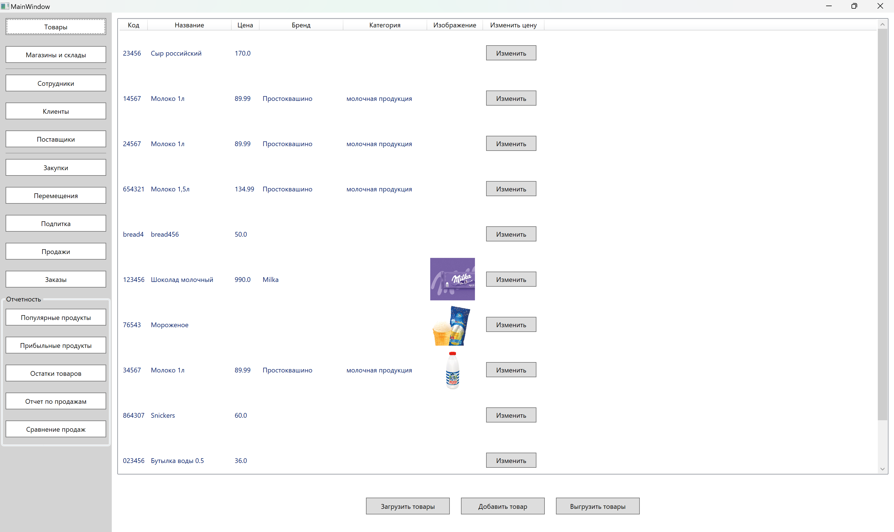
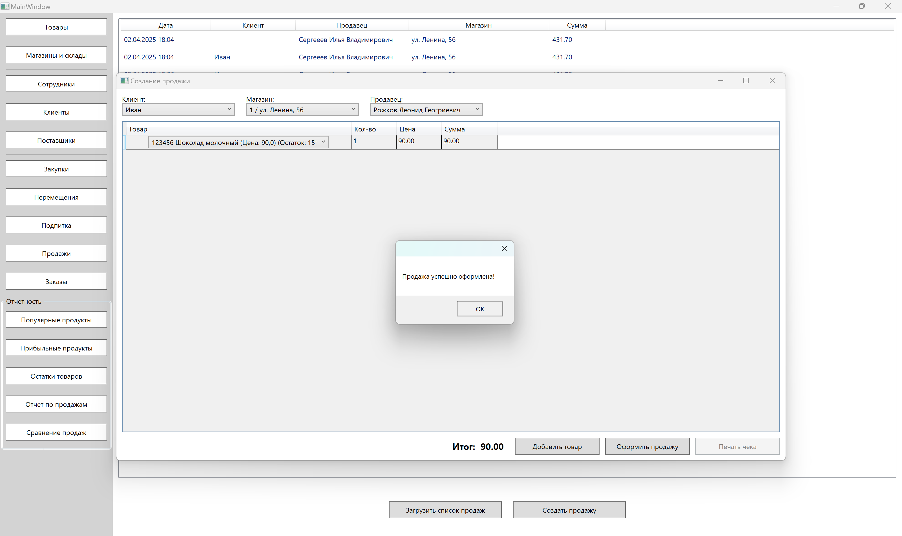
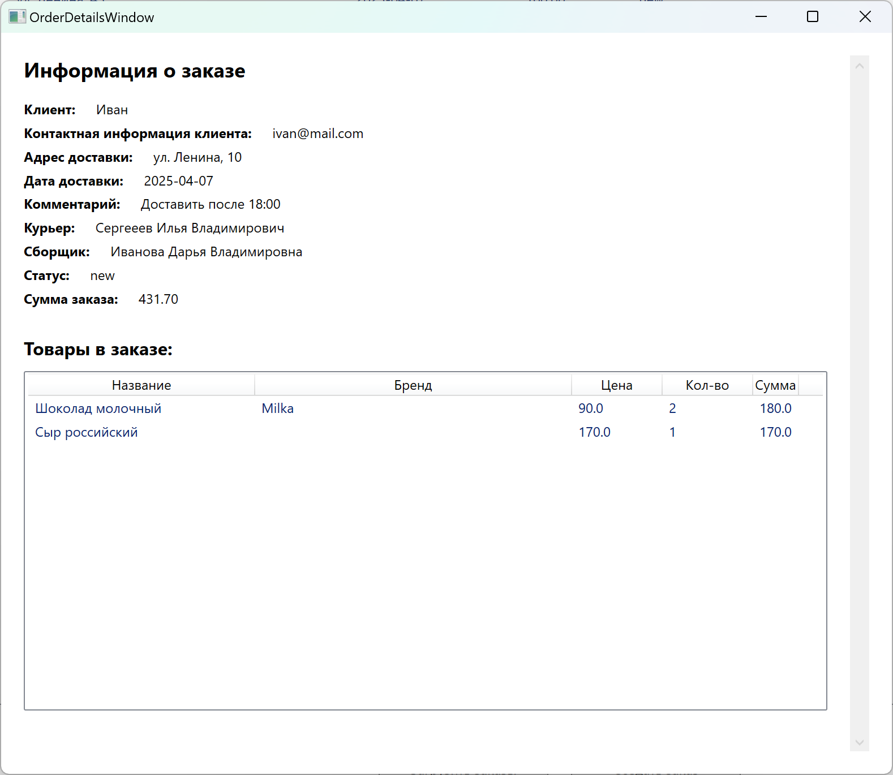
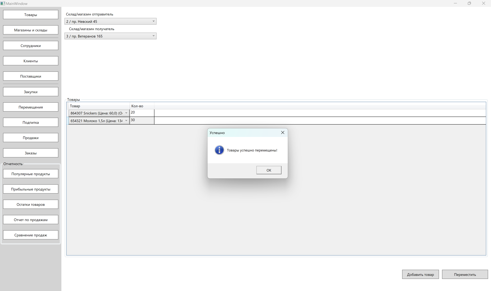
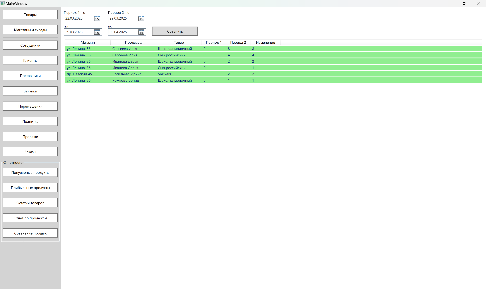
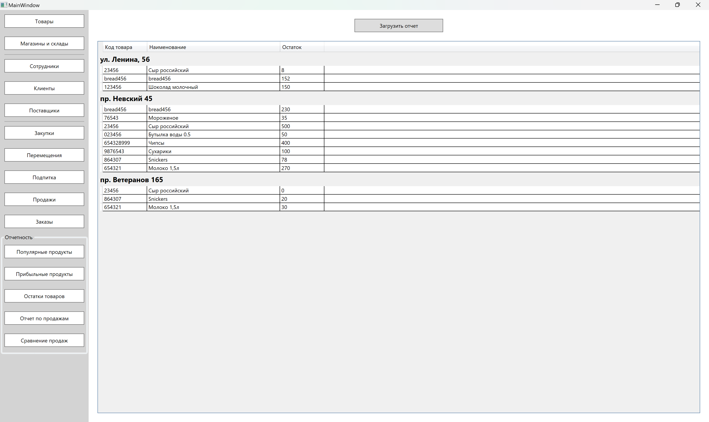

## Desktop-приложение для учётной системы торговых процессов
### Этот проект был выполнен в учебных целях в рамках командной работы:
- API (Django REST Framework) — разработка напарницы;
- Desktop (C# WPF) — моя часть проекта.

Так как это учебный проект, упор был сделан на функциональность, а не на внешний вид интерфейса. Примеры с красивым интерфейсом можно посмотреть в других проектах.

### Описание
Приложение является частью учетной системы торговых процессов. 
Оно позволяет работать с товарами, клиентами, поставщиками, сотрудниками, магазинами и складами, а также оформлять продажи, поставки и перемещения.

### Используемые технологии
- C# WPF (MVVM)
- .NET Framework 4.8
- Взаимодействие с сервером через REST API

### Основной функционал

- управление товарами (добавление, изменение цены, хранение изображений, экспорт в каталог);
- учёт магазинов, складов, клиентов, сотрудников и поставщиков;
- оформление поставок и перемещений товаров с проверкой остатков;
- оформление продаж (автоматический выбор продавца, расчёт итоговой суммы, печать чека в PDF);
- отчёты:
    1. продажи за период (по магазинам, продавцам и товарам);
    2. остатки по складам;
    3. топ-10 популярных товаров (диаграмма);
    4. динамика продаж за два периода (с подсветкой изменений);
- создание и просмотр заказов;
- поиск товаров с максимальной прибылью за выбранный период.

### Скриншоты

Далее представлены несколько скринов для демонстрации функционала программы

